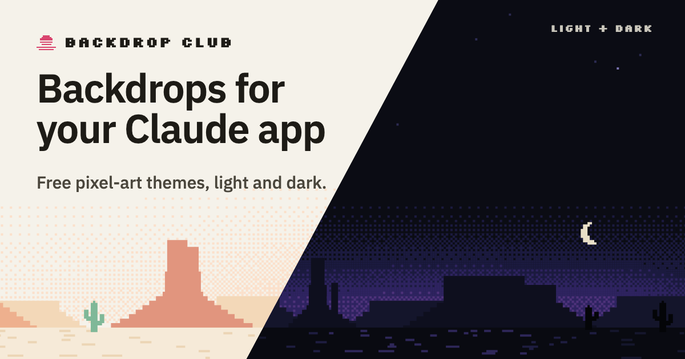

# Backdrop Club

**Free, community-made backdrops for the Claude desktop app.** Pixel-art cities and landscapes that sit at the bottom of the window, so your chat stays easy to read. Every theme has a light look and a dark look.

**Browse the gallery: https://backdrop-club.netlify.app/**



## Use it

Paste this into Claude Code (the desktop app's Code tab, or a terminal) once:

```
/plugin install backdrop-club --marketplace faiqhilman13/backdrop-club
```

Answer `y` to add the marketplace and pick a scope. Start a new session and send a message: a backdrop appears. Then switch any time:

| Command | What it does |
| --- | --- |
| `/backdrop tokyo` | Show a theme from the gallery, by id or name |
| `/backdrop random` | A surprise |
| `/backdrop list` / `/backdrop list city` | What the gallery has, or one tag |
| `/backdrop off` / `/backdrop on` | Hide it, bring it back |

Your pick is remembered across sessions. New themes show up for everyone as soon as they're merged: no update needed.

## Or let your agent do it

Paste this to Claude Code, Codex, OpenCode, Gemini CLI, Cursor or any agent with a shell:

> Read https://backdrop-club.netlify.app/llms.txt then show me the Backdrop Club backdrops with their preview images, and set up the one I pick in my Claude app.

It uses the no-install command line (Node 18+):

```
npx -y github:faiqhilman13/backdrop-club list          # every theme, with preview links (--json for agents)
npx -y github:faiqhilman13/backdrop-club setup         # install the loader in Claude Code, once
npx -y github:faiqhilman13/backdrop-club use tokyo     # an open session switches within seconds
npx -y github:faiqhilman13/backdrop-club download tokyo --out .
```

Also `search`, `show`, `tags`, `current`, `off`, `on`, `check` and `submit`. Inside Claude Code, Claude gets two tools from the loader, so "give me a backdrop with mountains" just works. More on the [Agents page](https://backdrop-club.netlify.app/agents/).

## Make one

- **From a photo:** the [maker](https://backdrop-club.netlify.app/make/) dithers any picture into a light and a dark backdrop, right in your browser.
- **By hand:** one SVG file. The [guide](https://backdrop-club.netlify.app/guide/) has the rules and a starter file.

## Share one

Check it on the [Submit page](https://backdrop-club.netlify.app/submit/), then press **Copy and open GitHub**. A bot checks your theme and opens a pull request; once merged it's live. Details in [CONTRIBUTING.md](CONTRIBUTING.md).

## The rules (why chat stays readable)

1. The scene lives in the bottom third of the window. The middle stays clear.
2. Chat text keeps at least **4.5:1 contrast** in both modes. A headless browser renders every theme at three window sizes and measures the darkest 1% of where text sits.
3. Pale colours by day, dark ones by night; bright colours only as small accents low down.
4. Still pictures only: no scripts, animation, fonts or outside links. At most 120,000 characters.

## Safe by design

Themes are data, not code. Each file is checked against an allow-list of SVG drawing elements when it's submitted, again when the site is built, and again by the loader before it draws it. The app draws it in a sandbox with scripts off. The only code you install is the small loader in [`plugin/`](plugin/), which you can read in a few minutes.

## How it's built

| Path | What |
| --- | --- |
| `themes/<id>/` | One folder per theme: `theme.json` and `backdrop.svg` |
| `lib/check.mjs` | The rulebook, shared by the site, the bot and the loader |
| `plugin/` | The loader mod people install |
| `tools/build.mjs` | Builds the site into `dist/` (`--render` adds scores and share images via Chrome) |
| `cli/backdrop.mjs` | The command line, run with `npx -y github:faiqhilman13/backdrop-club` |
| `tools/submission.mjs` | The bot that turns submission issues into pull requests |
| `site/` | Page styles and scripts, including the photo maker |
| `art/` | The Python kit that drew the starter themes, and their sources ([how to draw one](art/README.md)) |
| `site/revoked.json` | Themes taken down; installed loaders drop them too |
| `.github/workflows/` | Deploy, PR checks, the submission bot, and an optional mirror to a second host |

No dependencies: Node 22 and Chrome. `node tools/build.mjs --render && node tools/serve.mjs` serves it at http://127.0.0.1:4173/backdrop-club/.

---

An unofficial fan project, not affiliated with or endorsed by Anthropic. Code under the MIT licence; each theme under the licence in its `theme.json` (CC BY 4.0 unless stated).
